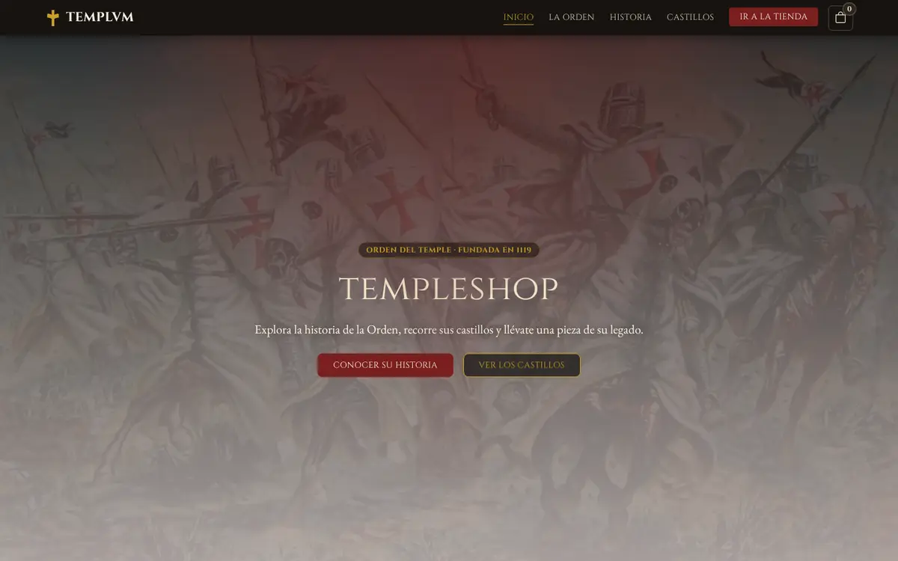
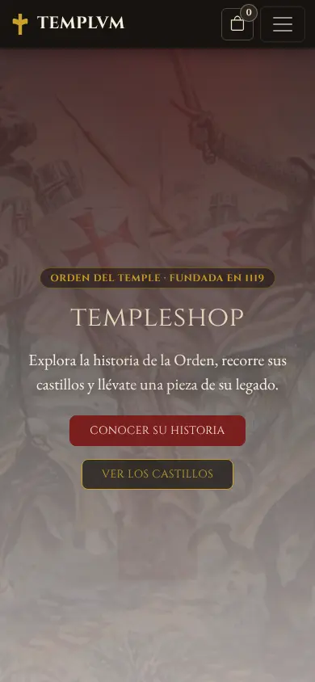

# Templvm

Sitio web sobre la Orden del Temple: su historia, sus castillos y una tienda de réplicas y objetos inspirados en la Orden. Empezó como laboratorio de la materia Construcción de Software (Ingeniería de Sistemas, Universidad Santo Tomás, Tunja) y se terminó como proyecto de portafolio.

**Sitio publicado:** https://templvm-kyotto44.netlify.app

<p>
  
  
</p>

## Funcionalidades

- **Cinco páginas**: inicio (portada y los cuatro pilares de la Orden), historia (cronología en acordeón), castillos (seis fortalezas, cada una con su foto), tienda y una página 404 con el mismo estilo del sitio.
- **Carrito de compras** hecho con JavaScript:
  - Botón "Agregar" en cada producto, con un aviso flotante que confirma lo que se agregó.
  - Contador de piezas en la barra de navegación, visible en todas las páginas.
  - Panel lateral con los productos: cambiar cantidades (de 1 a 10 por pieza), quitar productos, subtotal por producto y total.
  - El carrito se guarda en el navegador (`localStorage`), así que se mantiene al cambiar de página o recargar.
  - Estado vacío con un camino de vuelta a la tienda.
  - "Finalizar compra" simulado: muestra un resumen del pedido y deja claro que es una demostración. No hay pagos ni se piden datos de tarjeta.
- **Menú móvil** que se cierra con Escape y al tocar un enlace a una sección de la misma página.
- **Accesibilidad**: enlace "Saltar al contenido", foco visible en todos los controles, navegación completa con teclado, anuncios para lectores de pantalla en el carrito y respeto por la preferencia de movimiento reducido del sistema.
- **Diseño adaptable**: probado en 390 px (celular) y 1440 px (escritorio), con botones táctiles de al menos 44 px.

## Tecnologías

- HTML5 y CSS3 (`css/estilos.css`, con variables de la marca).
- [Bootstrap 5.3.8](https://getbootstrap.com/) por CDN: rejilla, barra de navegación, acordeón, offcanvas (panel del carrito) y toast (aviso al agregar).
- [Bootstrap Icons 1.11.3](https://icons.getbootstrap.com/).
- JavaScript sin frameworks (`js/carrito.js` y `js/menu.js`).
- Google Fonts: Cinzel (títulos) y EB Garamond (texto).
- Imágenes en formato WebP.

## Cómo abrirlo

No necesita instalación ni servidor.

1. Descarga o clona la carpeta del proyecto.
2. Abre `index.html` con doble clic, o con la extensión **Live Server** de Visual Studio Code (clic derecho sobre `index.html` → "Open with Live Server").

Necesita conexión a internet para cargar Bootstrap, los íconos y las fuentes desde sus CDN.

Para probar el carrito: entra a la tienda, agrega productos, abre el panel con el botón de la bolsa en la barra de navegación, cambia cantidades, recarga la página o ve a otra sección (el contador se conserva) y termina con "Finalizar compra".

> Algunos navegadores, como Firefox, pueden separar el almacenamiento de cada archivo abierto con doble clic; si el carrito no se conserva entre páginas, ábrelo con Live Server.

## Estructura de carpetas

```
templvm/
├── index.html          Inicio: portada y pilares de la Orden
├── historia.html       Cronología de la Orden (acordeón)
├── castillos.html      Seis fortalezas templarias
├── tienda.html         Catálogo con botones para agregar al carrito
├── 404.html            Página de error con caminos de vuelta
├── favicon.svg         Ícono del sitio (cruz pattée dorada)
├── css/
│   └── estilos.css     Estilos propios sobre Bootstrap
├── js/
│   ├── carrito.js      Carrito: catálogo, panel, contador, aviso y compra simulada
│   └── menu.js         Mejoras del menú móvil (Escape, cierre al navegar)
├── img/
│   ├── hero.webp       Imagen de la portada
│   └── castillos/      Fotos de los castillos (WebP)
├── docs/               Capturas usadas en este README
├── netlify.toml        Cabeceras de seguridad y caché para Netlify
├── README.md
└── CAMBIOS.md          Qué se cambió al terminar el proyecto y por qué
```

## Seguridad

Es un sitio estático: no tiene servidor, base de datos, claves de API ni funciones en la nube, así que no hay nada que un bot pueda usar para gastar recursos o leer datos.

- `netlify.toml` agrega cabeceras de seguridad en Netlify: una política de contenido (`Content-Security-Policy`) que solo permite los recursos que el sitio usa, bloqueo para que otras páginas no lo metan en un `iframe`, `nosniff`, HTTPS obligatorio y caché para las imágenes.
- Carga Bootstrap y Bootstrap Icons desde jsDelivr con verificación de integridad (`integrity`): si el archivo del CDN llegara a cambiar, el navegador no lo ejecuta.

## Créditos

- Las imágenes son de terceros y se usan con fines educativos.
- Las fotos de Ponferrada, Gisors, Monzón, Miravet y Peñíscola son de Wikimedia Commons, con licencias CC BY y CC BY-SA. El autor y la licencia de cada una aparecen al final de `castillos.html`.
- La tienda es una demostración: no procesa pagos ni pedidos reales.
- Bootstrap, Bootstrap Icons, Cinzel y EB Garamond son proyectos de código abierto de sus respectivos autores.
